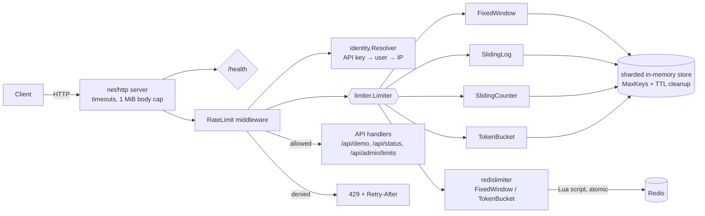

# ThrottleX

A concurrent, configurable HTTP rate-limiting service and library in Go. It ships four rate-limiting algorithms implemented from scratch, an optional Redis backend so several instances share one quota, and tests that check correctness under concurrent load.


- **4 algorithms** behind one interface: fixed window, sliding window log, sliding window counter, token bucket.
- **Concurrency-safe**: sharded locks, atomic check-and-consume. Stress tests prove that concurrent requests never exceed the limit.
- **Bounded memory**: a maximum key count plus background cleanup of expired client state.
- **Distributed mode**: Redis + Lua scripts (fixed window and token bucket), with a configurable fail-open/fail-closed policy.
- **Standards-style headers**: `RateLimit-Limit`, `RateLimit-Remaining`, `RateLimit-Reset`, `Retry-After`, and consistent JSON errors.
- **Safe client identification**: hashed API keys, trusted-proxy-only `X-Forwarded-For`, IPv6 /64 grouping.
- **Standard library first**: `net/http`, `log/slog`, `testing`. The only runtime dependency is the Redis client.

---

## Quick start

### Run locally (requires Go 1.26+)

```bash
go run ./cmd/server
```

```bash
curl -i http://localhost:8080/api/demo
```

To try a tiny limit (PowerShell syntax shown; in bash use `THROTTLEX_LIMIT=5 go run ./cmd/server`):

```powershell
$env:THROTTLEX_ALGORITHM="fixed_window"; $env:THROTTLEX_LIMIT="5"; go run ./cmd/server
```

Then call `/api/demo` six times. The sixth request returns `429 Too Many Requests`.

### Run with Docker (two instances + Redis)

```bash
docker compose up --build
```

Instance 1 listens on `localhost:8081` and instance 2 on `localhost:8082`. Both share one quota (10/min by default) through Redis. Spread 12 requests across the two ports and the last two are rejected, no matter which instance they hit.

### Run the tests

```bash
go test ./...
go test -race ./...          # needs cgo: works out of the box on Linux/macOS/WSL; on Windows needs a 64-bit gcc
docker compose up -d redis
THROTTLEX_TEST_REDIS_ADDR=localhost:6379 go test -v ./limiter/redislimiter/   # against real Redis
```

In PowerShell, set the variable first: `$env:THROTTLEX_TEST_REDIS_ADDR="localhost:6379"; go test -v ./limiter/redislimiter/`

Without `THROTTLEX_TEST_REDIS_ADDR`, the Redis tests use [miniredis](https://github.com/alicebob/miniredis), an in-process Redis, so `go test ./...` works on any machine. CI runs both modes with the race detector.

---

## API

| Method & path | Rate limited | Description |
|---|---|---|
| `GET /health` | no | Liveness probe: `{"status":"ok"}` |
| `GET /api/demo` | yes | Example protected endpoint |
| `GET /api/status` | yes | Backend, algorithm, allowed/denied counters, tracked keys |
| `GET /api/admin/limits` | yes | Active policy. Needs `Authorization: Bearer $THROTTLEX_ADMIN_TOKEN`; returns 404 if no token is configured |

**Allowed response headers**

```
RateLimit-Limit: 100        # limit (or bucket capacity)
RateLimit-Remaining: 97     # requests still allowed right now
RateLimit-Reset: 42         # seconds until the quota is fully restored
```

**When the limit is exceeded**

```
HTTP/1.1 429 Too Many Requests
Retry-After: 15
Content-Type: application/json

{"error":"rate_limit_exceeded","message":"too many requests, please retry later","retry_after_seconds":15}
```

Other errors use the same shape: `400 invalid_client_identifier`, `401 unauthorized`, `413 payload_too_large`, `503 rate_limiter_unavailable`.

---

## Architecture



```
throttlex/
├── cmd/server/            main: config → limiter → middleware → server, graceful shutdown
├── limiter/               reusable library, no HTTP code
│   ├── limiter.go         Limiter interface, Decision, Options, errors
│   ├── clock.go           Clock interface + ManualClock for deterministic tests
│   ├── store.go           sharded, bounded, expiring per-key state + janitor
│   ├── fixed_window.go    sliding_log.go    sliding_counter.go    token_bucket.go
│   └── redislimiter/      Redis + Lua implementations
├── internal/
│   ├── config/            env-var loading and validation
│   ├── identity/          client identification (API key, user, IP)
│   ├── middleware/        RateLimit middleware (headers, 429, failure policy)
│   ├── server/            routes, admin auth, body limit
│   ├── httpjson/          consistent JSON responses
│   └── observability/     atomic counters for /api/status
├── benchmarks/README.md   methodology and measured results
├── docs/LEARNING_GUIDE.md Go concepts used, mapped to files
├── Dockerfile  docker-compose.yml  .env.example  .github/workflows/ci.yml
```

`limiter` lives at the top level rather than under `internal/`, so other Go programs can import it:

```go
l, _ := limiter.NewTokenBucket(10, 1, limiter.Options{}) // burst 10, 1 req/s
d, _ := l.Allow(ctx, "user-42")
if !d.Allowed { time.Sleep(d.RetryAfter) }
```

### The interface

```go
type Limiter interface {
    Allow(ctx context.Context, key string) (Decision, error)
}
type Decision struct {
    Allowed    bool
    Limit      int
    Remaining  int
    RetryAfter time.Duration // 0 when allowed
    ResetAfter time.Duration // until the quota is fully restored
}
```

`Allow` checks *and* consumes quota in one call. Separate `Check` and `Consume` methods would let two concurrent requests both pass the check before either consumes. `ctx` lets a Redis call be abandoned when the client disconnects. The `error` return exists for backends that can fail (Redis), and for bounded memory (`ErrTooManyKeys`).

---

## Algorithms

| Algorithm | State per key | Accuracy | Bursts | Notes |
|---|---|---|---|---|
| Fixed window | 1 counter + window start | Boundary burst: up to **2×limit** across a window edge | Yes, at boundaries | Cheapest, easiest to explain |
| Sliding log | 1 timestamp per allowed request (8 B × limit) | **Exact** rolling window | No | Memory grows with the limit; capped at 100,000 |
| Sliding counter | 2 counters + window start | Approximate: assumes the previous window was uniform | Small | Close to the log's accuracy at the counters' cost |
| Token bucket | tokens (float) + last refill time | Exact for its model | Up to `capacity`, then a smooth `rate` | Default; best general-purpose choice |

**Fixed window.** Counts requests in aligned windows (12:00:00–12:00:59, …). The boundary-burst problem: with 100/min, a client can send 100 requests at 12:00:59 and 100 more at 12:01:00, which is 200 in one second. `TestFixedWindow/boundary_burst` demonstrates it.

**Sliding window log.** Stores the timestamp of each allowed request in a fixed-size **ring buffer**. Dropping expired timestamps is `head++`, with no shifting or reallocation. A request is allowed while fewer than `limit` timestamps are younger than `window`. `RetryAfter` is exactly when the oldest timestamp leaves the window.

**Sliding window counter.** `estimate = prev × (1 − elapsed/window) + curr`. It is an approximation: if all of last window's requests came at its very end, the true rolling count is higher than the estimate. `TestSlidingCounterIsAnApproximation` shows a case where the counter allows a request that the exact log denies. In exchange, its memory is constant regardless of the limit (83 B/key vs 995 B/key for the log at limit 100; see [benchmarks](benchmarks/README.md)).

**Token bucket.** There is no background refill timer. Each request computes `tokens += elapsed × rate`, capped at capacity. That makes idle keys free. `RetryAfter = (1 − tokens) / rate`.

`TestRetryAfterIsAccurate` checks that, for every algorithm across several limits and start offsets, waiting exactly `RetryAfter` makes the next request succeed.

---

## Concurrency design

- **Atomic decisions.** Each key's state is read, updated and written under its shard's mutex, inside a single `Allow` call. The clock is read *inside* the lock, so per-key timestamps never go backwards.
- **Sharded locks (64 shards).** A random-seeded `maphash` spreads keys across shards, so attackers cannot aim keys at one shard. The alternatives:
  - *Global mutex*: simplest, but every client contends on one lock.
  - *Per-key mutex*: no cross-client contention, but deleting a mutex while another goroutine holds a reference to it is a subtle race.
  - *Sharding*: keeps cleanup simple, because one lock guards both the map and the state.

  Measured on this project's hardware, 64 shards were **~7× faster than 1 shard** at 12 workers across 10k keys.
- **Bounded memory.** `MaxKeys` is enforced exactly with an atomic add-then-check counter. When the store is full, the new key's shard is swept first. If it is still full, the request gets `503` (even under fail-open, because otherwise flooding new keys would bypass limiting).
- **Safe cleanup.** Each entry records when its state becomes indistinguishable from a brand-new key. Deleting it from then on cannot change any decision, and expired entries are also reset lazily on access. The janitor locks one shard at a time.
- **Predictable shutdown.** SIGINT/SIGTERM stops new connections, gives in-flight requests 10 s to finish, cancels the janitor, and waits for it to exit (`sync.WaitGroup`).
- **Deterministic tests.** All time-dependent tests use `limiter.ManualClock`, with no `time.Sleep`. Stress tests freeze the clock, run 50+ goroutines against one key, and assert that **exactly** `limit` requests were accepted, while a concurrent sweeper runs in a tight loop.

---

## Redis mode

A Go mutex protects memory in one process only. It does nothing for two processes sharing Redis. Atomicity comes from **Lua scripts**: Redis runs a script start to finish with no other command interleaved, so "read → decide → write" is atomic across all instances.

| Algorithm | Redis implementation | Why |
|---|---|---|
| Token bucket | Hash `{tokens, ts}`, refilled in Lua using Redis's own `TIME` | All instances share one clock, so app-server clock skew cannot mint tokens |
| Fixed window | `GET`/`INCR` + `PEXPIRE` in Lua; window starts at a key's first request | No dependence on app clocks. Denied requests aren't counted |
| Sliding log / counter | **Not implemented** | The log would need a sorted set with one member per request. Config validation rejects these with `THROTTLEX_BACKEND=redis` |

Every key has a TTL, so Redis state cannot grow without bound. Each call has a timeout (`THROTTLEX_REDIS_TIMEOUT`, default 100 ms).

**Failure policy** (`THROTTLEX_FAILURE_POLICY`), used when Redis errors or times out:

| Policy | Behavior | Availability | Security |
|---|---|---|---|
| `open` (default) | Request is allowed, a warning is logged, `fail_open_allowed` is counted | API stays up if Redis dies | **No rate limiting during the outage**: abusive clients get through |
| `closed` | `503 rate_limiter_unavailable` + `Retry-After: 1` | A Redis outage becomes an API outage | Limits are never bypassed |

Choose `open` when the limiter protects against accidental overload, and `closed` when it guards something abuse-sensitive (login, SMS, paid APIs).

---

## Configuration

All settings are environment variables, validated at startup. All problems are reported together. See [.env.example](.env.example) for every variable.

| Variable | Default | Meaning |
|---|---|---|
| `THROTTLEX_ADDR` | `:8080` | Listen address |
| `THROTTLEX_LOG_LEVEL` | `info` | `debug`, `info`, `warn`, `error` |
| `THROTTLEX_BACKEND` | `memory` | `memory` or `redis` |
| `THROTTLEX_ALGORITHM` | `token_bucket` | `fixed_window`, `sliding_log`, `sliding_counter`, `token_bucket` |
| `THROTTLEX_LIMIT` / `THROTTLEX_WINDOW` | `100` / `1m` | Window algorithms |
| `THROTTLEX_BUCKET_CAPACITY` / `THROTTLEX_REFILL_RATE` | `LIMIT` / `LIMIT÷WINDOW` per s | Token bucket |
| `THROTTLEX_IDENTITY` | `apikey,user,ip` | Identification order |
| `THROTTLEX_API_KEY_HEADER` / `THROTTLEX_USER_HEADER` | `X-API-Key` / `X-User-ID` | Header names |
| `THROTTLEX_TRUSTED_PROXIES` | *(none)* | CIDRs allowed to set `X-Forwarded-For` and the user header |
| `THROTTLEX_MAX_KEYS` / `THROTTLEX_CLEANUP_INTERVAL` | `100000` / `1m` | Memory bounds |
| `THROTTLEX_REDIS_ADDR`, `_PASSWORD`, `_DB`, `_TIMEOUT`, `_KEY_PREFIX` | `localhost:6379`, –, `0`, `100ms`, `throttlex:` | Redis |
| `THROTTLEX_FAILURE_POLICY` | `open` | `open` or `closed` |
| `THROTTLEX_ADMIN_TOKEN` | *(none: admin disabled)* | ≥16 chars |

## Security notes

- **Forwarded headers.** `X-Forwarded-For` and the user-ID header are ignored unless the TCP peer is in `THROTTLEX_TRUSTED_PROXIES`. The client IP is the rightmost untrusted hop, because leftmost entries can be forged.
- **API keys** are validated (printable ASCII, ≤256 bytes) and **SHA-256 hashed** before use. Raw keys never reach limiter memory, Redis, or logs. Logs never include client keys.
- **IPv6 clients** are grouped by /64, since one customer typically controls a whole /64.
- **Admin token** comparison is constant-time (on SHA-256 digests). Admin routes sit behind the rate limiter, which also slows token guessing.
- **Resource limits**: server read/write/idle timeouts (Slowloris), 1 MiB header and body caps, `MaxKeys`, Redis TTLs, and a distroless non-root container.

## Benchmarks

Full methodology, commands and raw results are in [benchmarks/README.md](benchmarks/README.md). Highlights (Go benchmarks, i5-12450H, Windows 11, Go 1.27.2; single run, so expect a few % of noise):

- Every algorithm runs in roughly **75–100 ns per `Allow`** single-threaded, with **0 allocations**.
- With 12 workers spread over 10k keys, throughput scales to **~26–30 ns/op**. With 12 workers hammering one hot key, it degrades to ~125–150 ns/op, because a single key means a single lock.
- 64 lock shards vs 1 global mutex at 12 workers: **28 vs 201 ns/op**.
- Memory: **83 B per tracked key** (fixed window, sliding counter), **99 B** (token bucket), and **995 B** for the sliding log at limit 100.
- Measured optimization: replacing `time.Truncate` with integer math cut the fixed window from 160 to 101 ns/op and the sliding counter from 140 to 78 ns/op.

HTTP load tests (`hey`) and real-Redis benchmarks have commands ready in the benchmarks doc, but no numbers have been recorded yet.

## Limitations and next steps

- The Redis backend supports two of the four algorithms.
- One global policy. Per-route or per-plan policies, and a runtime policy-update endpoint, are not implemented.
- `RateLimit-*` headers follow the IETF draft's separate-header form; the draft is still evolving.
- `MaxKeys` sweeps only the new key's shard on insert; full reclamation relies on the janitor interval.

## License

[MIT](LICENSE)
